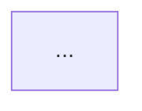

# Visualize

A picture earns its place only when it shows something words can't — shape, structure, direction, relationship, geometry. This skill produces ONE such picture, checks that it is **correct** (the maker renders it and looks at it before returning), and drops it into the lesson page.

You are the **creative director**. You decide the exact idea and distill it to its fewest carrying elements. A **maker subagent** does the authoring, rendering, and visual verification, then returns **source text**. You paste that source into the lesson page.

## When to visualize (and when not to)

This teaching system builds a **dependency graph in the learner's head** — foundations at the root, derived facts hanging off them. A visual is powerful exactly when it makes that structure (or a geometry) visible. Reach for one when:

- The idea is a **structure or relationship**: dependencies, a system with parts and arrows, a flow/pipeline, a sequence of exchanges, a state machine, a tree/hierarchy, a comparison, a containment (what's inside vs outside).
- The idea is **spatial or geometric**: coordinate geometry, a number line, vectors, a function's shape, a physical arrangement.

Do NOT visualize when prose or a single equation already carries it. A decorative diagram that just restates the sentence next to it adds noise and a chance to be wrong. When in doubt, don't — a missing visual is cheaper than a false one.

## Choose the maker

- **`mermaid-maker`** — structural/relational visuals: dependency graphs, flowcharts, sequence/state/ER/class diagrams, trees, mindmaps, timelines. This is the default and fits the dependency-graph pedagogy directly.
- **`svg-maker`** — spatial/geometric visuals Mermaid can't lay out: exact coordinates, geometry figures, number lines, vectors, plots, custom shapes.

Rule of thumb: if it's *nodes-and-edges / relationships*, use mermaid-maker. If it's *positions-and-shapes / geometry*, use svg-maker.

**A simple dependency DAG does not need a maker at all.** If you can write the four-line `graph TD` yourself and you are confident it is right, just write it into the lesson page. Dispatch a maker when the diagram is big enough, or geometric enough, that being wrong is a real risk.

## Brief the maker well: one idea, fewest elements

The most common failure is **cramming** — every extra label makes the picture harder to read AND harder to lay out correctly. Before briefing, prune to the fewest elements that carry the idea, and for each ask: *"if I delete this, is the idea still clear?"* If yes, delete it.

Give the maker the concept AND the concrete elements you want — not a vague topic, and not a long checklist.

- BAD: "make a diagram about how TCP works"
- GOOD: "graph TD: a node 'packet' at the top; arrows down to 'ordering' and 'retransmit on loss'; both arrows down into 'reliable stream'. No title. Show that reliability is built FROM packets, not alongside them."

Keep the idea intact but trust the maker to compose; if your brief lists more than ~5–7 elements, cut it first.

## Invoke

Dispatch with the **Agent** tool, `subagent_type: "mermaid-maker"` or `"svg-maker"`.

**The brief MUST include a scratch directory path.** The makers write their source and PNG there. Use the session scratchpad directory — never a path inside the project, so no working files land in the repo. Say it plainly in the prompt, e.g.:

> Scratch directory: `<absolute scratchpad path>`. Write your working files there.

The maker writes source, renders it to a PNG with `.claude/tools/render.mjs`, reads the PNG to look at it, iterates until it is correct and clean, and returns:

```
RESULT:

```

If it returns `RESULT: NONE`, it couldn't make a correct picture of the brief — simplify or rethink, or decide the visual isn't worth it. Never hand-author a diagram you would have dispatched a maker for; the point of the maker is that something actually looked at the result.

## Put it in the lesson page

The lesson page is HTML, and it renders both formats natively — no image files, no uploads, and the page stays self-contained.

- **Mermaid** → wrap the returned source in `<pre class="mermaid">…</pre>`.
- **SVG** → paste the returned `<svg>…</svg>` inline, as-is.

Introduce the visual in a sentence, then let it carry the idea — don't narrate every element back in prose.

## What verification does and does not guarantee

Be precise about this, because it is easy to overclaim:

- **It does guarantee** the source is syntactically valid and that a human-equivalent look confirmed it says the true thing: arrows the right way round, correct labels, nothing clipped or cramped, geometry actually derived rather than eyeballed. "Renders fine but asserts something false" is the failure this catches, and it is the one that matters most in teaching.
- **It does not guarantee pixel-identical output.** The maker verified a PNG; the learner's browser re-renders the source itself. For **SVG** the two are effectively identical, since SVG is deterministic. For **Mermaid** the browser's own Mermaid build does the layout, so fonts and spacing can differ slightly from what the maker saw. A diagram that only *just* fit when the maker looked at it may sit differently for the learner — which is one more reason to keep diagrams sparse.
